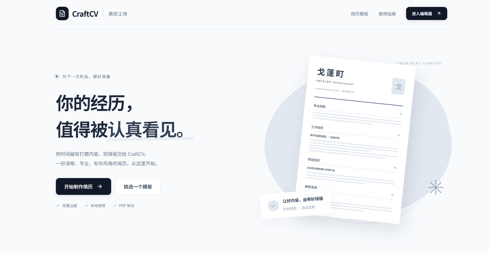

# CraftCV · 简历工坊

[English](README.md) | 简体中文

CraftCV 是一款无需注册的浏览器端简历编辑器，用于编写、预览并导出专业简历。



## 核心功能

- 从主页开始制作，也可直接通过 `#/editor` 进入编辑器。
- 分模块编辑个人信息、教育背景、专业技能、工作经历、项目与成果，右侧实时预览 A4 效果。
- 提供经典与极简两种布局，切换时保留已有内容。
- 支持头像上传与裁剪、字体与配色调整，以及通过浏览器打印窗口导出 PDF。
- 支持近期编辑的撤销／重做，以及 JSON 备份导入和导出。

## 数据与隐私

简历数据仅保存在当前浏览器的 `localStorage` 中；项目不提供账号和服务端存储。清理浏览器数据或更换设备前，请先导出 JSON 备份。

内置简历为匿名示例，仅用于展示排版和技术表达方式。加载旧版本内置示例缓存时，会自动迁移为当前匿名示例。

## 单页排版与文字 PDF

预览工具栏的「适配单页」会收紧排版并按真实内容高度适配 A4，预览与普通「导出 PDF」使用相同规则，保留可选择、复制的文字。「自适应」与百分比只调整屏幕查看大小，不会改变页数。

单页设置会自动保存并保留在 JSON 备份中，可点击「恢复分页」退出。内容过多、需要缩小到 85% 以下时会继续分页并提示精简，避免裁切内容或无限缩小文字。浏览器打印请选择 A4、100% 缩放并关闭页眉页脚。

## 招聘网站兼容 PDF

普通「导出 PDF」保留可选择和复制的文字，推荐优先使用。如果北森等招聘网站提示文件“含有非法代码”，可从编辑器「更多 → 导出兼容 PDF（图片版）」下载新文件后重试。

兼容版在本机浏览器将排版绘制成图片，再生成结构简单的 A4 PDF；不嵌入字体、超链接、表单、脚本或浏览器标签树。内容较长时自动分页，在页尾附近寻找空白行，避免切断文字。无需向服务端发送简历。

**图片版不能选择、搜索或复制文字，招聘系统自动解析依赖 OCR。** 请保留普通文字版和 JSON 备份；兼容导出不能保证通过所有平台的扫描，仍需在目标网站上传验证。文件被拒收本身不证明 PDF 有恶意代码。

## 本地运行

```bash
npm install
npm run dev
```

打开 Vite 输出的本地地址。构建并预览生产版本：

```bash
npm run build
npm run preview
```

## 验证

```bash
npm run lint
npm test
npm run build
```

## 技术栈

React 19 · TypeScript · Vite · Tailwind CSS v4 · Motion

## 协议

[MIT](LICENSE)
